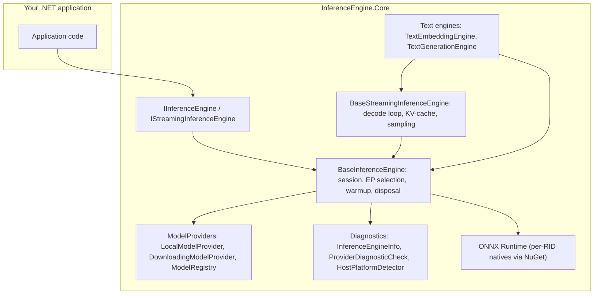
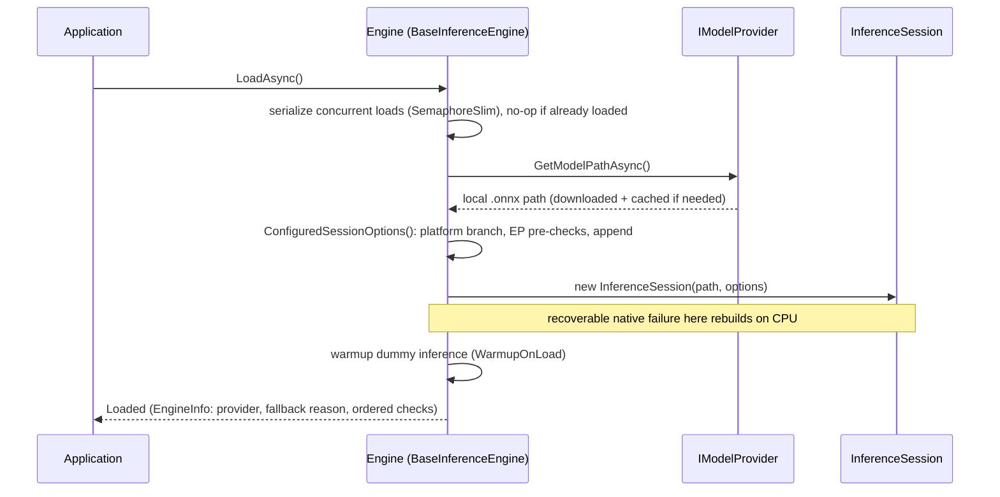

# InferenceEngine.Core — Architecture

## 1. Executive Summary

This repository produces **InferenceEngine.Core**, a cross-platform .NET 10 library that puts ONNX Runtime inference behind a generic, testable engine contract: `IInferenceEngine<TInput, TOutput>` with one `LoadAsync`/`PredictAsync` shape.

The library owns the plumbing every .NET ONNX app otherwise reimplements: model download and caching, execution-provider selection with automatic CPU fallback, load-time warmup, tensor pre/post-processing, and full native-resource disposal. On top of the one-shot contract it layers an additive streaming contract (`IAsyncEnumerable<TStep>`) for autoregressive decode with KV-cache carry-back, and string-in/string-out text engines with tokenization built in.

**Core Philosophy:** a consumer subclass implements only its model-specific tensor math (`PreProcessWithContext` / `PostProcessWithContext`, or the three streaming hooks); the base class handles everything else and records every provider-selection decision in an ordered diagnostic trail.

---

## 2. Component Overview

| Component | Key types | Role |
| :--- | :--- | :--- |
| Contract | `IInferenceEngine<TInput,TOutput>`, `IStreamingInferenceEngine<TInput,TOutput,TStep>` | `LoadAsync`/`PredictAsync`; streaming adds `PredictStreamingAsync` returning `IAsyncEnumerable<TStep>` |
| One-shot base | `BaseInferenceEngine<TInput,TOutput>` | Owns the `InferenceSession`, execution-provider resolution, warmup, model-provider wiring, diagnostics, and `Dispose` |
| Streaming base | `BaseStreamingInferenceEngine<TInput,TOutput,TStep>` | Autoregressive decode loop on the inherited session; `PredictAsync` routes through the stream and reduces via `BuildFinalOutput` |
| Options | `InferenceEngineOptions`, `StreamingOptions`, `SamplingParams` | GPU/device/warmup/provider configuration; per-call streaming controls (max steps, EOS ids, temperature/top-k/top-p/repetition penalty) |
| Model acquisition | `IModelProvider`, `LocalModelProvider`, `DownloadingModelProvider`, `ModelRegistry` (`models.json`) | Name-to-path resolution: local file, or download with prioritized URL fallback into a per-user cache |
| Diagnostics | `InferenceEngineInfo`, `InferenceEngineStatus`, `ProviderDiagnosticCheck`, `InferenceProvider`, `InferenceFallbackReason`, `HostPlatformDetector` | Ordered provider-selection trail, load-state transitions, fallback reasons |
| Text engines | `TextEmbeddingEngine`, `TextGenerationEngine`, `TokenizerAssets` (internal) | String-in/string-out engines on top of the bases; tokenization via `Microsoft.ML.Tokenizers` |
| Out-of-process host | `OutOfProcessBaseInferenceEngine<TInput,TOutput>` | Adds `IAsyncDisposable` host/worker plumbing over the same base (see `Worker/`) |
| Examples | `FaceDetectionEngine`, `StreamingTextGenerationExample` (separate project, unpackable) | Reference implementations: YOLO11 vision pipeline; streaming decode skeleton |

---

## 3. Execution-Provider Resolution

`BaseInferenceEngine.ConfiguredSessionOptions` is the single choke point. Called once per `LoadAsync`, it inspects `UseGpuAcceleration` and the detected `HostPlatform`, then takes exactly one branch:

| Host platform | Branch | Provider | Path to success |
| :--- | :--- | :--- | :--- |
| `LinuxX64` | `TryRocmBranch` | MIGraphX | Precondition chain (below), then append, then session construction |
| `WinX64`, `WinArm64` | `TryDirectMlBranch` | DirectML | `AppendExecutionProvider_DML(deviceId)` → session |
| `OSX64`, `OSXArm64` | `TryCoreMlBranch` | CoreML | `AppendExecutionProvider_CoreML(COREML_FLAG_ENABLE_ON_SUBGRAPH)` → session |
| `LinuxArm64` / unknown | `TryCpuBranch` | CPU | No GPU attempted — `InferenceFallbackReason.UnsupportedPlatform` |
| `UseGpuAcceleration = false` | early exit | CPU | `InferenceFallbackReason.UserDisabledGpu` |

### 3.1. Linux x64 precondition chain

The MIGraphX EP is appended only after every probe passes, in order:

1. **`/dev/kfd` exists** — the ROCm kernel driver node; its absence means no AMD GPU driver (`KfdDeviceMissing`).
2. **`libhsa-runtime64.so` loads** — HSA runtime (`HsaRuntimeUnloadable`).
3. **`libamdhip64.so.7` loads** — HIP runtime (`HipRuntimeMissing`).
4. **`libmigraphx_c.so.3` loads** — MIGraphX runtime (`MIGraphXRuntimeMissing`).
5. **`AppendExecutionProvider("MIGraphX", …)`** — with `device_id` and the resolved `.mxr` model-cache directory (`ProviderAppendFailed` on exception).
6. **Session construction** — where MIGraphX compiles the model's kernels.

Any failed probe skips the remaining GPU checks and builds CPU-only session options with the granular `InferenceFallbackReason`. Independently, if session construction throws a recoverable native failure (`IsRecoverableNativeFailure`), the whole session is rebuilt on CPU (`NativeLibraryLoadFailed`) — this catches driver/GPU problems the pre-checks cannot see.

### 3.2. MIGraphX compiled-model cache

`InferenceEngineOptions.MIGraphXModelCacheDirectory` controls the `.mxr` cache: `null` (default) uses a per-user directory under `LocalApplicationData`, `""` disables caching, a non-empty string is used verbatim. Cache files are keyed by MIGraphX version, graph identity, GPU architecture, and input shapes, so the first load of a model compiles (~1–2 minutes) and later starts load the saved program (~1–2 seconds). A host that cannot create the cache directory still gets GPU inference — the cache is an optimization, never a requirement.

### 3.3. The diagnostic trail

Every probe, append, and session-construction step is recorded as an ordered `ProviderDiagnosticCheck` (pass/fail/skip with detail) and mirrored to the logger. The trail is published on `InferenceEngineInfo.Checks` after `LoadAsync`, and load-state transitions (`Loading → Loaded | Failed`) are surfaced through `InferenceEngineOptions.OnStatusChanged` / `OnSessionInitialized` callbacks. This is what makes "why is my engine on CPU?" a one-lookup answer.

### 3.4. Testability

The platform-specific steps are virtual seams — `EffectivePlatform`, `IsKfdPresent`, `TryLoadNativeLibrary`, `AppendMIGraphXProvider`/`AppendDirectMlProvider`/`AppendCoreMlProvider`, `CreateInferenceSession` — so the fallback matrix is exercised hermetically in unit tests on any host, with no GPU.

---

## 4. Native-Library Strategy

### 4.1. ONNX Runtime natives arrive per-RID via NuGet

The managed `Microsoft.ML.OnnxRuntime` package resolves `runtimes/<RID>/native` assets per RID. Windows DirectML support comes from `Microsoft.ML.OnnxRuntime.DirectML`, referenced only when `RuntimeIdentifier` starts with `win` (RID-gated, so cross-RID builds never pull DirectML assets). macOS CoreML is included in the base package. Linux x64 MIGraphX support comes from the sibling package **InferenceEngine.ROCm.Runtime.linux-x64**, referenced only on `linux-x64` — a MIGraphX-enabled build of `libonnxruntime.so` plus `libonnxruntime_providers_migraphx.so`.

The Core csproj sets `RuntimeIdentifier` to the host RID by default, so a plain `dotnet build` produces RID-specific output and all post-Build targets below fire automatically on any host.

### 4.2. The MIGraphX `libonnxruntime.so` override (linux-x64)

NuGet resolves two packages' `libonnxruntime.so` to the same output path, and the vanilla CPU-only library wins. That library has no MIGraphX entry point, so the EP append would fail with `Unable to find an entry point named 'OrtSessionOptionsAppendExecutionProvider_MIGraphX'`. Two MSBuild targets fix the output, one per execution context:

- **`ForceRocmOnnxRuntimeLibOnLinux`** (in `buildTransitive/`, shipped in the NuGet package) runs for **consumers** of the package. It copies the ROCm build's `libonnxruntime.so` over the output copy, resolving the source path from the `$(Pkg…)` property or a version-agnostic NuGet-cache glob so version bumps need no edits here. Inline targets in a csproj do not run for package consumers — that is why this lives in `buildTransitive`.
- **`ForceRocmOnnxRuntimeLibOnLinuxStandalone`** (inline in the csproj) is the mirror image for **building Core itself**, where `buildTransitive` does not apply but the ROCm package is a direct reference, so `$(Pkg…)` is populated.

The ROCm-enabled library is safe to load on non-ROCm hosts — the MIGraphX EP fails with a managed exception (unlike the deprecated ROCm EP, which crashed in its `.init` section), and § 3.1's pre-checks prevent the append attempt entirely.

### 4.3. Linux P/Invoke symlinks (`SymlinkLinuxNativeLibsForPInvoke`)

The upstream managed ORT package's P/Invoke declarations use a Windows-style DllImport name (`"onnxruntime.dll"`). .NET's probe order on Linux covers `libonnxruntime.dll.so`, `onnxruntime.dll.so`, `libonnxruntime.dll`, and `onnxruntime.dll` — but **not** `libonnxruntime.so`, the filename the packages actually ship. After Build (gated on a Linux RID and a Unix host, so cross-compiling from Windows stays quiet) the target creates symlinks from the probed names to the real `.so` files for the runtime and each provider library. The symlinks are tiny and removed by `dotnet clean`.

### 4.4. Windows-native cleanup on non-Windows (`RemoveWindowsNativeLibsOnNonWindows`)

Upstream ORT/Extensions props unconditionally copy the Windows native DLLs (`onnxruntime.dll`, `ortextensions.dll`, `onnxruntime_providers_shared.dll`) to the output root on **every** RID. On a non-Windows host, `dlopen` finds those PE32+ files first and fails with `invalid ELF header` before falling through to the correctly-named Linux libraries. After Build (gated on a non-Windows RID) the target deletes the three stray DLLs so native probing goes straight to the ELF libraries.

---

## 5. Model Acquisition

`BaseInferenceEngine.GetModelProvider` resolves the `IModelProvider` in a fixed order:

1. `InferenceEngineOptions.ModelProvider` (explicit — wins over everything; `ModelPath` is a shortcut that sets a `LocalModelProvider`).
2. The engine's `ModelDownloadUrls` override → a `DownloadingModelProvider`.
3. `ModelRegistry` lookup of `ModelName` in `models.json` (packaged as content, loaded from the app directory) → a `DownloadingModelProvider`.
4. Otherwise: `InvalidOperationException` naming all three fixes.

`DownloadingModelProvider` tries URLs in priority order and caches under `{LocalApplicationData}/InferenceEngine/Models` (overridable per engine via `ModelCacheDirectory`), so a model is downloaded once per user and every later load is a file open. Text engines reuse the same provider for tokenizer assets under `…/InferenceEngine/Tokenizers`.

---

## 6. Streaming Decode Loop

`BaseStreamingInferenceEngine<TInput, TOutput, TStep>` runs one loop, driven by three engine hooks:

| Step | Hook | Notes |
| :--- | :--- | :--- |
| Prefill (`step == 0`) | `BuildStepInputs(input, state, 0)` | Full prompt; empty `past_key_values` |
| Decode (`step > 0`) | `BuildStepInputs(input, state, step)` | Single token; prior `present_*` carried back as `past_*` via `CloneAsPastKeyValue` |
| Per step | `ProcessStepOutputs(outputs, buildContext)` | Returns the streamed step, next KV-cache state, and `IsEos`; logits sampling via `SampleNextToken` (greedy argmax default; temperature/top-k/top-p/repetition-penalty built in with pooled buffers) |
| End | `BuildFinalOutput(steps)` | Reduces the step list to the one-shot `TOutput` |

The base owns stop rules (`MaxSteps`, EOS ids), step-boundary cancellation, the single-in-flight-stream guard (KV-cache state is per-run), and per-step disposal. One-shot parity is structural: `PredictAsync` runs the stream to completion and reduces it.

---

## 7. Data Flow

### 7.1. `LoadAsync` — provider → session → warmup

### 7.2. `PredictAsync` — pre-process → Run → post-process

```mermaid
sequenceDiagram
    participant App as Application
    participant E as Engine (BaseInferenceEngine)
    participant S as InferenceSession

    App->>E: PredictAsync(input)
    E->>E: lazy LoadAsync() if not loaded
    E->>E: PreProcessWithContext(input) → tensors + context
    E->>S: Run(tensors, outputNames, runOptions)
    S-->>E: output tensors
    E->>E: PostProcessWithContext(outputs, context) → TOutput
    E->>E: input tensors disposed (finally)
    E-->>App: TOutput
```

The context object is the thread between the two halves: preprocessing computes what postprocessing needs (image scale factors, token mappings) and hands it over without statics or fields, keeping engines stateless per call and safe to reuse.

`Dispose` releases the session and run options deterministically; streaming engines reject a second concurrent stream instead of interleaving KV-cache state.

---

## 8. Versioning & Packaging Invariants

- Package: `InferenceEngine.Core` targets **net10.0** and ships the repo README as its `PackageReadmeFile`.
- Version: `{VERSION_PREFIX}[-suffix].{run_number}` per branch (`development` → `-dev.`, `main` → `-rc.`, `release` → stable).
- The ROCm runtime package version tracks the ORT source version (e.g. `1.24.1.36`), independent of this package's own version line.
- `models.json` ships as package content (`contentFiles/any/any`) and is copied to consumer output so `ModelRegistry` finds it at runtime.
