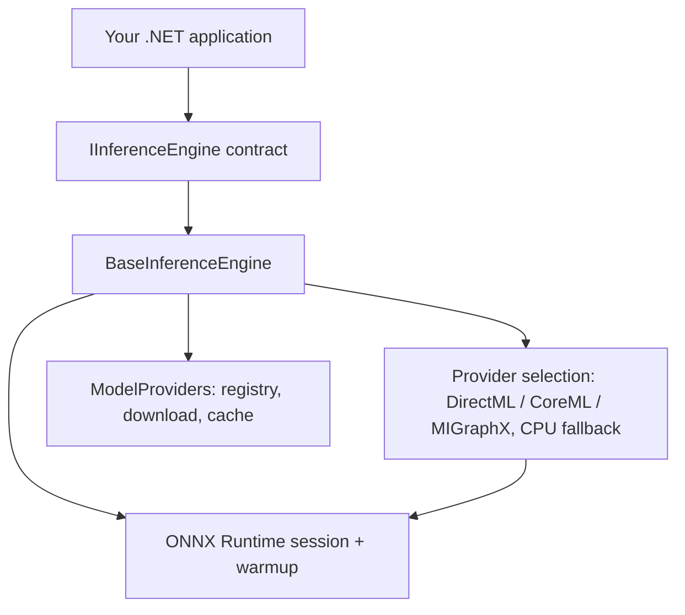

# InferenceEngine.Core

**A cross-platform .NET library for AI inference with ONNX Runtime.**

[](https://github.com/intel-agency/inference-engine-lib/actions/workflows/build-test.yml)
[](https://www.nuget.org/packages/InferenceEngine.Core)
[](LICENSE)
[](https://dotnet.microsoft.com/)
[](https://intel-agency.github.io/inference-engine-lib/)
[](https://codecov.io/gh/intel-agency/inference-engine-lib) [](https://intel-agency.github.io/inference-engine-lib/coverage/)
[](https://securityscorecards.dev/viewer/?uri=github.com/intel-agency/inference-engine-lib)

## The Problem

Every .NET ONNX application reimplements the same plumbing before a model ever runs:

- model download, verification, and local caching
- execution-provider selection — and what to do when the GPU isn't there
- warmup, so the first real request isn't orders of magnitude slower than the rest
- tensor pre/post-processing wired to your own domain types
- session lifecycle and native-memory cleanup

ONNX Runtime's .NET API is session-centric and imperative: you configure a `SessionOptions`, append an execution provider, and call `Run` on named tensors. Nothing hands you a *testable engine contract* — so every app wires the plumbing differently.

## The Solution

`InferenceEngine.Core` collapses all of it behind one contract:

```csharp
public interface IInferenceEngine<TInput, TOutput> : IDisposable
{
    Task LoadAsync();
    Task<TOutput> PredictAsync(TInput input);
}
```

- **Hardware auto-detection** — DirectML on Windows, CoreML on macOS, MIGraphX (ROCm) on Linux x64 — each with automatic CPU fallback and an ordered diagnostic trail that records exactly which provider was selected and why.
- **Registry-driven model acquisition** — name a model; the engine finds it in `models.json`, downloads it with URL fallback, and caches it under the user profile.
- **Warmup and full lifecycle** — `LoadAsync` runs a dummy inference so GPU kernels compile up front; the engine is `IDisposable` end to end.
- **Streaming decode** — autoregressive generation as `IAsyncEnumerable<TStep>` with KV-cache carry-back, on the same instance and the same session.

## Quick Start

### Install

```bash
dotnet add package InferenceEngine.Core
```

### Your first engine

Subclass `BaseInferenceEngine<TInput, TOutput>` and implement exactly two methods — preprocess (your input in, ONNX tensors out) and postprocess (ONNX output in, your type out):

```csharp
using InferenceEngine.Core;
using Microsoft.ML.OnnxRuntime;
using Microsoft.ML.OnnxRuntime.Tensors;

public class RegressorEngine : BaseInferenceEngine<float[], float>
{
    public RegressorEngine(InferenceEngineOptions options) : base(options) { }

    protected override string ModelName => "regressor.onnx";

    // Raw input -> ONNX tensors. The context object carries any state
    // (e.g. normalization factors) over to post-processing — no globals needed.
    protected override (List<NamedOnnxValue> InputTensors, object? Context) PreProcessWithContext(float[] features)
    {
        var tensor = new DenseTensor<float>([1, features.Length]);
        features.CopyTo(tensor.Buffer.Span);
        return ([NamedOnnxValue.CreateFromTensor("features", tensor)], null);
    }

    // ONNX output -> your domain type.
    protected override float PostProcessWithContext(
        IDisposableReadOnlyCollection<DisposableNamedOnnxValue> output, object? context)
        => output.First().AsEnumerable<float>().First();
}
```

Then load and predict:

```csharp
var engine = new RegressorEngine(new InferenceEngineOptions
{
    ModelPath = "models/regressor.onnx", // or omit: resolved by ModelName via the model registry
    UseGpuAcceleration = true,           // DirectML / CoreML / MIGraphX, CPU fallback
    WarmupOnLoad = true                  // compile GPU kernels at load, not on first request
});

await engine.LoadAsync();
float prediction = await engine.PredictAsync(sampleFeatures);

engine.Dispose();
```

> If you omit `ModelPath`, the engine resolves the model by `ModelName`. If that name isn't in the built-in registry, the engine tells you which of the three fixes to apply: add the model to `models.json`, override `ModelDownloadUrls`, or set `ModelProvider` explicitly.

### Object detection out of the box

[`FaceDetectionEngine`](InferenceEngine.Examples/FaceDetectionEngine.cs) in the repo's Examples project is a complete YOLO11 pipeline — SkiaSharp preprocessing, coordinate-space mapping, and non-maximum suppression:

```csharp
using InferenceEngine.Core;
using InferenceEngine.Examples;
using Microsoft.Extensions.Logging.Abstractions;

var engine = new FaceDetectionEngine(
    new InferenceEngineOptions { UseGpuAcceleration = true },
    NullLogger<FaceDetectionEngine>.Instance);

await engine.LoadAsync();   // yolo11n.onnx downloads and caches automatically on first load
var detections = await engine.PredictAsync(File.ReadAllBytes("street.jpg"));

foreach (var d in detections)
    Console.WriteLine($"{d.Label} {d.Confidence:P0} at [{d.X}, {d.Y}, {d.Width}, {d.Height}]");
```

### `InferenceEngineOptions`

| Property | Default | Description |
| :--- | :--- | :--- |
| `UseGpuAcceleration` | `true` | Use the platform GPU provider; `false` forces CPU on every OS |
| `DeviceId` | `0` | GPU index for multi-GPU hosts |
| `WarmupOnLoad` | `true` | Dummy inference during `LoadAsync` to pre-compile GPU graphs |
| `ModelPath` | `null` | Local `.onnx` path — convenience shortcut that sets a `LocalModelProvider` |
| `ModelProvider` | `null` | Explicit `IModelProvider`; overrides all other resolution |
| `MIGraphXModelCacheDirectory` | per-user default | Linux x64: persist compiled MIGraphX programs (`.mxr`) so restarts skip the ~1–2 min compile; an empty string disables caching |
| `OnStatusChanged` | `null` | Callback on every load-state transition, with the full diagnostics object model on failure |
| `OnSessionInitialized` | `null` | Callback fired once after the session is created — tells you which provider actually loaded |

## Features

| Capability | Description |
| :--- | :--- |
| **Generic engine contract** | `IInferenceEngine<TInput, TOutput>` — one `LoadAsync`/`PredictAsync` shape for any model; mockable and testable without a GPU |
| **Hardware acceleration with fallback** | DirectML (Windows), CoreML (macOS), MIGraphX/ROCm (Linux x64); automatic CPU fallback with a granular, ordered diagnostic trail |
| **Cross-platform** | Targets `win-x64`, `win-arm64`, `linux-x64`, `linux-arm64`, `osx-x64`, `osx-arm64` |
| **Model registry + download cache** | JSON registry, prioritized URL fallback, per-user cache directory |
| **Context passing** | Share preprocessing state (scale factors, token maps) with post-processing through a context object |
| **Warmup on load** | GPU shader/graph compilation happens in `LoadAsync`, eliminating first-request latency |
| **Resource safety** | Full `IDisposable` lifecycle — sessions, tensors, and native memory are released deterministically |
| **Streaming decode** | `IAsyncEnumerable<TStep>` autoregressive loop with KV-cache carry-back and greedy/temperature/top-k/top-p sampling |
| **Text engines** | String-in/string-out embedding and generation engines — tokenization handled for you |

## Architecture



Component reference, execution-provider resolution order, and the native-library strategy are documented in [ARCHITECTURE.md](ARCHITECTURE.md).

## Streaming inference

For autoregressive workloads (token-by-token text generation, step-wise diffusion), implement `BaseStreamingInferenceEngine<TInput, TOutput, TStep>`. It reuses everything from `BaseInferenceEngine` — session, hardware acceleration, model download, warmup, disposal — and adds an `IAsyncEnumerable<TStep>` decode loop:

```csharp
public interface IStreamingInferenceEngine<TInput, TOutput, TStep>
    : IInferenceEngine<TInput, TOutput>
{
    IAsyncEnumerable<TStep> PredictStreamingAsync(
        TInput input,
        StreamingOptions? options = null,
        CancellationToken cancellationToken = default);
}
```

### Consuming a stream

```csharp
await foreach (string chunk in engine.PredictStreamingAsync(
                   prompt,
                   new StreamingOptions { MaxSteps = 128, EosTokenIds = [2] },
                   cancellationToken))
{
    Console.Write(chunk);   // render tokens as they arrive
}
```

Streaming is **additive**: on the same instance, `PredictAsync` routes through the stream and reduces it via `BuildFinalOutput`, so one-shot consumers need no changes. Cancellation is honored at each step boundary and leaves the instance clean; a second concurrent stream on the same instance throws (KV-cache state is per-run).

`StreamingOptions` controls `MaxSteps`, `EosTokenIds`, `Sampling` (`Temperature`/`TopK`/`TopP`/`RepetitionPenalty` — greedy argmax by default), `IncludePrefillInStream`, and `ChunkSize`.

### Implementing a streaming engine

Subclass `BaseStreamingInferenceEngine<TInput, TOutput, TStep>` and implement three hooks. The base owns the loop, stop rules, cancellation, per-step disposal, and sampling:

| Hook | Responsibility |
| :--- | :--- |
| `BuildStepInputs(input, state, step)` | Assemble ONNX inputs for one forward pass — prefill (full prompt) on `step == 0`, decode (single token + carried KV cache) thereafter — and return carry-forward context. |
| `ProcessStepOutputs(outputs, buildContext)` | Decode one pass into the streamed step, the next KV-cache state, and an EOS flag. Use `SampleNextToken` for greedy sampling and `CloneAsPastKeyValue` to carry `present_*` outputs into `past_*` inputs. |
| `BuildFinalOutput(steps)` | Reduce the accumulated steps into the one-shot `TOutput`. |

```csharp
public class MyLlmEngine : BaseStreamingInferenceEngine<string, string, string>
{
    public MyLlmEngine(InferenceEngineOptions options, ILogger<MyLlmEngine>? logger = null)
        : base(options, logger) { }

    protected override string ModelName => "my-llm.onnx";

    protected override (List<NamedOnnxValue> Inputs, object? BuildContext) BuildStepInputs(
        string prompt, object? state, int step)
        => throw new NotImplementedException(); // tokenize; prefill on step 0, decode after

    protected override (string Step, object? NextState, bool IsEos) ProcessStepOutputs(
        IDisposableReadOnlyCollection<DisposableNamedOnnxValue> outputs, object? buildContext)
        => throw new NotImplementedException(); // sample logits, carry KV cache, detect EOS

    protected override string BuildFinalOutput(IReadOnlyList<string> steps)
        => string.Concat(steps);
}
```

> **Reference:** [`StreamingTextGenerationExample.cs`](InferenceEngine.Examples/StreamingTextGenerationExample.cs) is a documented skeleton showing prefill/decode tensor assembly, KV-cache carry-back, sampling, and EOS detection. Full design notes: [`docs/streaming-inference-guide.md`](docs/streaming-inference-guide.md).

## Text engines

`InferenceEngine.Core.Text` ships string-in/string-out engines that own tokenization and model/tokenizer asset fetching (backed by `Microsoft.ML.Tokenizers`), so consumers write no tokenizer code:

- **`TextEmbeddingEngine`** — all-MiniLM-L6-v2 embeddings (BERT WordPiece tokenizer; masked-mean pooling + L2 normalization). `BaseInferenceEngine<string, float[]>`.
- **`TextGenerationEngine`** — Phi-3-mini-4k-instruct streaming generation (SentencePiece tokenizer). `BaseStreamingInferenceEngine<string, string, string>`.

```csharp
using InferenceEngine.Core;
using InferenceEngine.Core.Text;

var options = new InferenceEngineOptions { UseGpuAcceleration = false };

using var embedder = new TextEmbeddingEngine(options);
await embedder.LoadAsync();
float[] embedding = await embedder.PredictAsync("Cross-platform ONNX inference for .NET");

using var generator = new TextGenerationEngine(options);
await foreach (string chunk in generator.PredictStreamingAsync("What is 2 + 2?"))
    Console.Write(chunk);
```

> **Note:** the Phi-3 cpu-int4 export is split across a `.onnx` and a `.onnx.data` external-data file; point `ModelPath` at a complete local bundle. Caveats and asset-fetch details: [`docs/text-engines-guide.md`](docs/text-engines-guide.md).

## Model providers

Model acquisition is decoupled from inference through `IModelProvider`:

| Provider | Behavior |
| :--- | :--- |
| `LocalModelProvider` | Resolves a path on disk; throws if the file is missing |
| `DownloadingModelProvider` | Tries a prioritized list of URLs, caches the result under the user profile |
| `ModelRegistry` | Maps a model name (e.g. `yolo11n.onnx`) to download URLs via `models.json` |

**Resolution order** when an engine loads:

1. Explicit `InferenceEngineOptions.ModelProvider` (if set)
2. The engine's `ModelDownloadUrls` override
3. `ModelRegistry` lookup by `ModelName`

The registry ships with common vision models (YOLO11n/s/m, YOLOv8n, YOLOv8n-face, ArcFace); the text engines carry their own model URLs. Extend it by adding an entry to [`InferenceEngine.Core/models.json`](InferenceEngine.Core/models.json):

```json
{
  "name": "my-custom-model.onnx",
  "description": "Custom model for my agent",
  "source": "My Org",
  "urls": [
    "https://example.com/models/my-custom-model.onnx"
  ]
}
```

## Hardware matrix

Provider selection happens in `BaseInferenceEngine.ConfiguredSessionOptions` at load time — per host platform, with CPU fallback at every step:

| OS / RID | Execution provider | Notes |
| :--- | :--- | :--- |
| **Windows** (`win-x64`, `win-arm64`) | DirectML | Appended with `DeviceId`; any failure falls back to CPU |
| **macOS** (`osx-x64`, `osx-arm64`) | CoreML | Appended with `COREML_FLAG_ENABLE_ON_SUBGRAPH`; any failure falls back to CPU |
| **Linux x64** (`linux-x64`) | MIGraphX (ROCm) | GPU is attempted only after every host precondition passes (see below); otherwise CPU with the exact reason |
| **Linux arm64** (`linux-arm64`) | CPU | No GPU provider attempted |

On Linux x64 the precondition chain is: `/dev/kfd` exists → `libhsa-runtime64.so` loads → `libamdhip64.so.7` loads → `libmigraphx_c.so.3` loads → the MIGraphX provider is appended (with `device_id` and the `.mxr` model-cache directory) → the session constructs. Any miss skips the remaining GPU steps and falls back to CPU, recording a granular reason (`KfdDeviceMissing`, `HipRuntimeMissing`, `MIGraphXRuntimeMissing`, …).

- `UseGpuAcceleration = false` forces CPU on every platform.
- If session construction itself fails with a recoverable native error (e.g. a GPU driver problem), the engine retries on CPU automatically.
- Every probe and decision is recorded as an ordered check trail — read `engine.EngineInfo.Checks` or subscribe to `OnStatusChanged` to find out *why* a provider was chosen.
- Linux GPU acceleration needs the ROCm user-space installed on the host (`hip-runtime-amd` + `migraphx`); the MIGraphX-enabled `libonnxruntime.so` is delivered by the [`InferenceEngine.ROCm.Runtime.linux-x64`](https://www.nuget.org/packages/InferenceEngine.ROCm.Runtime.linux-x64) package, referenced automatically on `linux-x64`.

## Requirements

| Component | Requirement |
| :--- | :--- |
| .NET | 10.0 |
| OS / RIDs | `win-x64`, `win-arm64`, `linux-x64`, `linux-arm64`, `osx-x64`, `osx-arm64` |
| GPU (optional) | Windows: any DirectX 12 GPU (DirectML) · macOS: Apple Silicon or AMD GPU (CoreML) · Linux x64: AMD GPU with ROCm user-space (HIP + MIGraphX) |
| Without a GPU | Fully supported — the engine runs on CPU everywhere |
| Disk | Space for model downloads (cached per user) |

## Versioning

Package versions follow `{VERSION_PREFIX}[-suffix].{run_number}` (SemVer 2.0). `VERSION_PREFIX` is a repository variable — currently `1.2`:

| Branch | Format | Example |
| :--- | :--- | :--- |
| `development` | `{VERSION_PREFIX}-dev.{run_number}` | `1.2-dev.142` |
| `main` | `{VERSION_PREFIX}-rc.{run_number}` | `1.2-rc.150` |
| `release` | `{VERSION_PREFIX}.{run_number}` | `1.2.151` |

The `1.2.x` line is the first public stable line; `1.1.x` was the pre-public line and is not on NuGet.org.

## Contributing

Contributions welcome — please open an issue first for significant changes. Feature branches target `development`, and commits must be GPG-signed. The full branching model, CI internals, and self-hosted ROCm runner setup live in [CONTRIBUTING.md](CONTRIBUTING.md); release notes are in [CHANGELOG.md](CHANGELOG.md). Guidelines for AI coding agents working in this repo are in [AGENTS.md](AGENTS.md).

## License

[MIT](LICENSE) — free for commercial and non-commercial use. Third-party notices are listed in [THIRD-PARTY-NOTICES.txt](THIRD-PARTY-NOTICES.txt).

